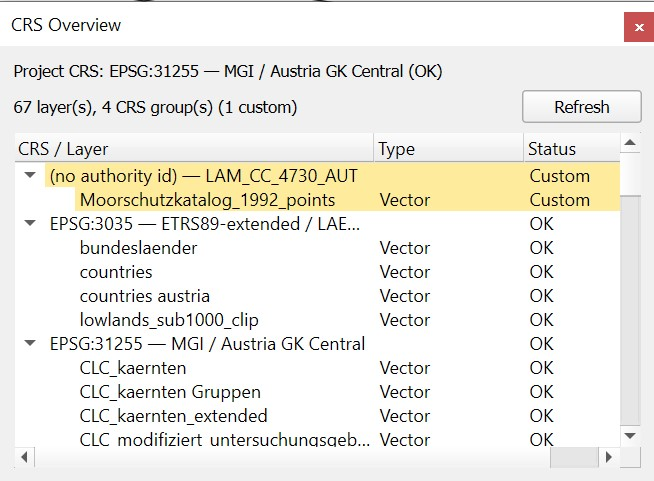

# CRS Overview

Lists every layer in the current project grouped by CRS, highlighting
layers whose CRS is custom (user-defined) or invalid — so mismatches
between layers are easy to spot before they cause problems downstream.

## Features

- Lists every layer in the current project, grouped by CRS
- Also shows the project's own CRS at the top of the panel, using the
  same status highlighting as the layer groups
- Flags each CRS group's status — OK (standard CRS from the shipped
  database), Custom (user-defined, or no authority id at all), or
  Invalid (unrecognised/unset) — with Invalid and Custom groups listed
  first, sorted by severity
- Works with both vector and raster layers
- Tables without geometry are listed separately at the end, without
  highlighting, since they don't need a CRS
- Automatically refreshes when layers are added or removed, or when
  the project's CRS changes
- Manual Refresh button
- Toolbar button lives in the Plugins Toolbar, or open via
  Plugins > CRS Overview

## Installation

**From the QGIS Plugin Repository** (show experimental plugins): Plugins > Manage
and Install Plugins > search "CRS Overview" > Install

**From a ZIP file**: Plugins > Manage and Install Plugins > Install from
ZIP > select the .zip > Install

## Requirements

QGIS 3.34 or later (tested on QGIS 3.44 and 4.2)

## Known limitation

Reassigning a layer's CRS in place (e.g. via layer properties, without
removing/re-adding the layer) doesn't fire the project signal the
automatic refresh listens for, so the panel won't update on its own.
Use the Refresh button in that case.

## How CRS status is determined

A CRS counts as Invalid if `crs.isValid()` is `False` — QGIS couldn't
resolve a usable definition for it at all. Otherwise it counts as
Custom if either its `authid()` is empty (an ad-hoc WKT/PROJ4
definition, e.g. from a layer's .prj, that was never matched to a
catalog entry) or its `srsid()` falls in QGIS's user-CRS range (a CRS
explicitly registered under Settings > Custom Coordinate Reference
Systems). Everything else counts as OK.

All layers with an invalid CRS are listed in one group. Each custom
CRS gets its own group, so layers only share a group if their CRS
definitions are identical.

## Changelog

- **0.2** — Each unknown CRS now gets its own group, and layers without
  a CRS always show as Invalid instead of being merged with custom CRS;
  tables without geometry are listed separately instead of being
  flagged Invalid; the panel comes to the front when opened while
  tabbed behind another panel; the plugin unloads cleanly
- **0.1** — Initial release

## License

GPL-3.0-or-later — see LICENSE.

## Acknowledgment

This plugin was created by Stephan Preinstorfer (LiberGIS) with the help of claude.ai.
